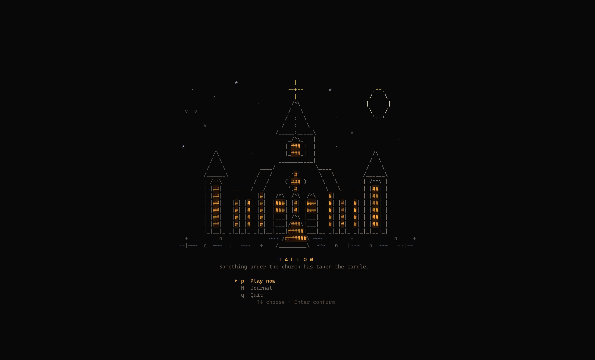
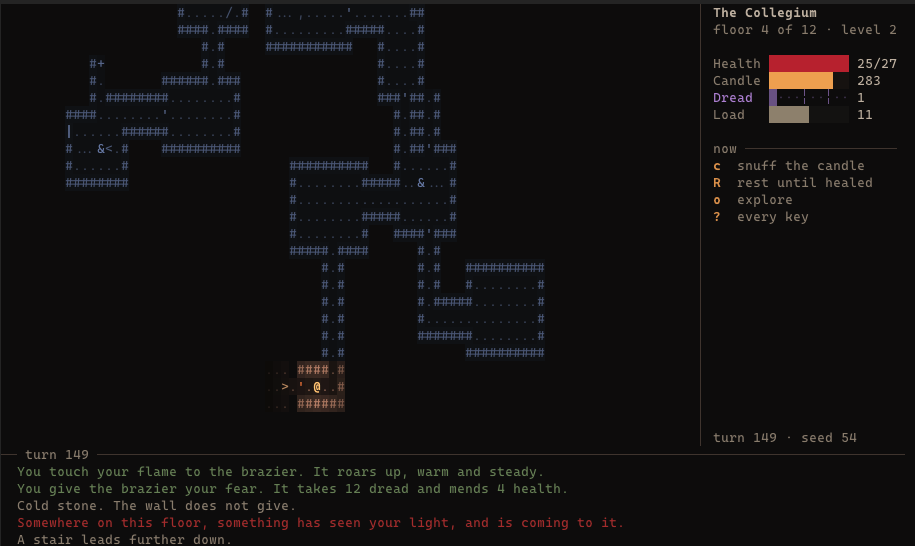

<div align="center">

# Tallow

**A dark-academia roguelike for the terminal.**
*Something under the church has taken the candle.*



</div>

---

All is not well at the Church of the Low Bell. The clergy dream one dream between them, and one by one they stop waking. Behind the altar a passage runs under the floorboards, and it does not stop going down.

You are the acolyte sent after them, and you go with a candle. It is your light and it is your clock. Every turn it burns lower, and no one has left tallow lying about for you down there. What you need you take from the things you kill.

There is no character to make. Press a key and you stand in the crypt. Who you become is decided on the way down: the weapon you keep returning to, the rites you choose to remember, how long you dare to walk without a light.

<div align="center">

<br>
<sub>Floor 4, the Collegium. The candle lights a small circle; what you have already seen fades to cold blue. The sidebar offers the keys that matter in the moment.</sub>
</div>

## Light and dark

Every choice below the church returns to one question: **do you light the candle, or not?**

- **Light** lets you see and fight well. It also burns tallow, and it is seen from far off. Keep it burning long on one floor and something new comes to find out why.
- **Darkness** spares the candle and lets you pass unnoticed. It is also where **dread** gathers. In the dark your blows go wide, theirs land harder, and some things show themselves only there.
- **Dread** is what rites are paid in, and the more you hold, the stronger they are. Hold too much and you see things that are not there. Then the **Nightmares** come for you, and at the very top your fear puts on a body and walks after you.

## What waits below

- **Four factions that hate one another nearly as much as they hate you.** Swarms flank you and quicken in the dark. The Taken were people once, and hang back from your light. The Remnant keep their posts. The Dreaming are scarcely there until light pins them down.
- **Weapons with a temper.** A sickle leaves wounds that keep bleeding. A censer spills coals. A boathook hauls things in. A verger's staff shoves them into whatever stands behind. No weapon answers everything, and something overhead will stay just out of your reach.
- **Bodies are a choice.** Study one to learn its kind's secrets, perhaps a rite among them, or render it down for tallow. You cannot do both.
- **Rites, learned from texts and the dead.** Sixteen of them, and none simply deals harm: bind a creature to your will, trade places with it, seal a door, push your dread into something else. Your mind holds only a few at once.
- **Leavings.** Objects found where the world has worn thin, each with its own rule and its own price. You can carry two.
- **Twelve floors down, four back up.** At the bottom sits the one who took the candle. Taking it back is the easy part. Climbing out with it is not.

## How to begin

### In your browser

Play it on **[itch.io](https://markomoth.itch.io/tallow-a-dark-fantasy-roguelike)**. It is the same game, played with the keyboard, and your run and journal are kept in that browser.

### Download

Take the latest build for Linux, Windows or macOS from **[Releases](https://github.com/markomoth/tallow/releases/latest)**, unpack it, and run `tallow` in a terminal at least **100×30**. The release page explains the one-time "unverified app" warning on macOS and Windows. What changed in each version is in the [changelog](CHANGELOG.md).

### Build it yourself

You will need [Rust](https://rustup.rs):

```sh
cargo run --release
```

Two flags worth knowing:

```sh
cargo run --release -- --seed 42   # walk (or walk again) a particular dungeon
cargo run --release -- --simple    # plain colors, your terminal's own background, no animation
```

`--simple` suits terminals without truecolor, light themes, transparent backgrounds, screen readers and recordings. It keeps to the 16 standard colors, leaves the background to your terminal, and redraws only when you press a key.

Quitting mid-run saves it, and the next launch picks up where you left off. What you learn about the creatures, rites and Leavings stays in your **journal** from one run to the next.

## Keys

| Key | What it does |
|---|---|
| arrows · `hjkl` · numpad | Move (walk into things to fight, open, ring, light) |
| `yubn` | Move diagonally |
| Shift + direction | Run |
| `o` | Explore on your own until something needs you |
| `.` · `R` | Wait a turn · rest until healed |
| `c` · `C` | Snuff or light the candle · shut the doors beside you |
| `g` · `i` | Pick up · open your pack |
| `t` · `f` | Throw · fire a sling or crossbow |
| `s` | Study or render the body underfoot |
| `z` | Rites: ↑↓ to read one, a letter or Enter to cast |
| `S` + direction | Shove a creature back |
| `G` | Guard: wait braced and answer every miss |
| `>` · `<` | Down the stairs · up, once you carry the Vigil Candle |
| `F` | Flare the Vigil Candle on the way back up |
| `x` | Look: a card beside the creature (Tab moves between them) |
| `@` · `M` · `?` | Your acolyte · the journal · help |
| `q` | Save and quit |

## The workings

Tallow is written in Rust with [ratatui](https://ratatui.rs). The game itself is a pure, deterministic library (`tallow-core`): the same seed and the same keypresses always play out the same way. That is how saves work, and how `tallow-sim`, a set of headless bots, plays hundreds of runs in different styles to hunt for softlocks and keep any one way of playing from winning alone.

The design document and the record of each milestone are in [`BUILD_GUIDE.md`](BUILD_GUIDE.md).

```sh
cargo test --workspace                     # every test
cargo run --release -p tallow-sim -- 500   # a bot plays 500 runs
cd crates/tallow-web && trunk serve        # the browser version, at localhost:8080
```
